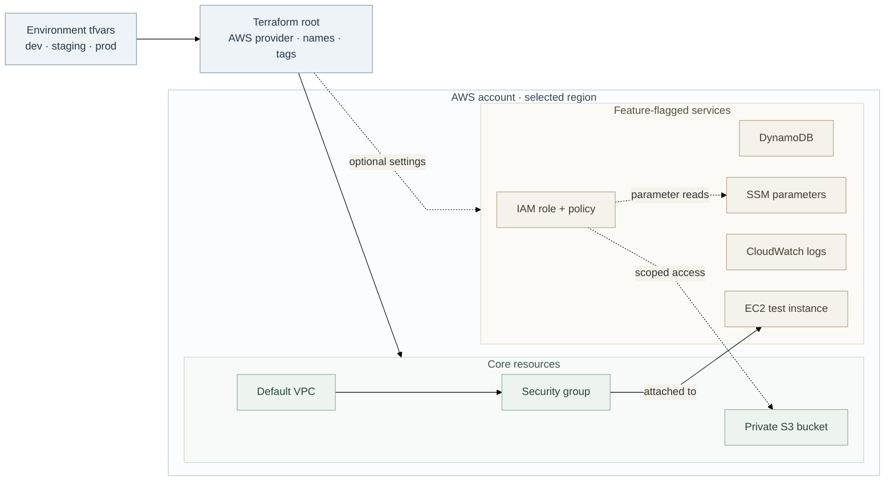

# Architecture

Each environment is configured with its own file under `envs/`. The same Terraform root creates resources in the selected AWS region; optional services are controlled by variables in the selected file.

The bucket is private. SSH is closed unless CIDRs are supplied. The IAM policy is scoped to the bucket and SSM parameters; the role has an EC2 trust policy but is not attached to the test instance. DynamoDB uses on-demand billing, SSM values are standard-tier strings, and log retention is configured per environment.

The supplied environment files enable DynamoDB, IAM, SSM, and CloudWatch logs. S3 versioning is off in dev and on in staging and prod; lifecycle expiration is enabled in all three. EC2 is off in every supplied environment and is restricted to dev with explicit approval.

This is a configuration-only project; no AWS resources have been applied. No Terraform modules are used. Resource names are assembled in `locals.tf` from company, project, environment, resource type, and region.
