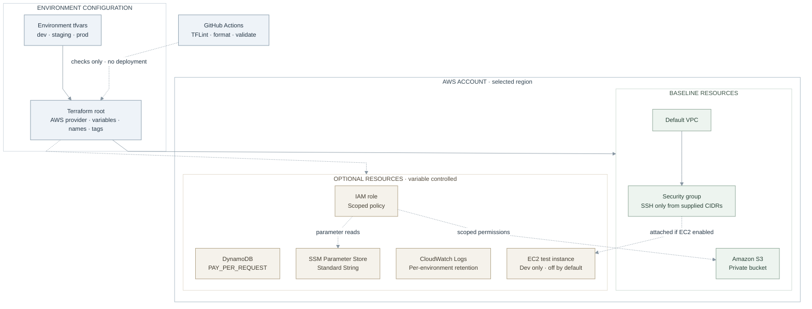

# Architecture

Each environment is configured with its own file under `envs/`. The same Terraform root manages the selected AWS region; optional services are controlled by variables in the selected file. Per assignment, apply and destroy dev only; staging and prod are plan-only.

Solid arrows show configuration flow and the default-VPC relationship. Dashed arrows show validation, optional provisioning, IAM policy scope, and the conditional EC2 security-group attachment. The IAM role has an EC2 trust policy but is not attached to the test instance. CI runs checks only; it does not apply infrastructure.

The bucket is private. The supplied tfvars files use `us-east-1`; other configured regions are selected through the environment setting. DynamoDB is on-demand, SSM values are standard-tier strings, and log retention is configured per environment.

The supplied environment files enable DynamoDB, IAM, SSM, and CloudWatch logs. S3 versioning is off in dev and on in staging and prod; lifecycle expiration is enabled in all three. EC2 is off in every supplied environment and is restricted to dev with explicit approval.

No Terraform modules are used. Resource names are assembled in `locals.tf` from company, project, the `owner` and `student_id` variables, environment, resource type, and region; for example, `bjit-tfassign-sumaiya-30245-dev-config-table-use1`.

The repository includes AWS screenshots and an earlier apply attempt that reported existing resources. Verify the current AWS account and Terraform state before applying or destroying; do not assume the diagram means resources are absent or that Terraform currently manages them.

## Design decisions

- One flat Terraform root keeps the assignment easy to inspect; environment differences are inputs from separate tfvars files rather than copied configurations.
- A shared naming prefix combines company, project, owner, student ID, environment, resource type, and region to make ownership and environment clear in AWS.
- `count` is used for optional singleton resources, while `for_each` creates parameter and log-group resources from keyed maps.
- Optional features are controlled by variables, and IAM permissions are limited to the application's bucket and SSM parameters.
- Cost-sensitive or risky resources are constrained: EC2 is opt-in and dev-only, SSH ingress is empty unless CIDRs are supplied, and log retention is bounded.
